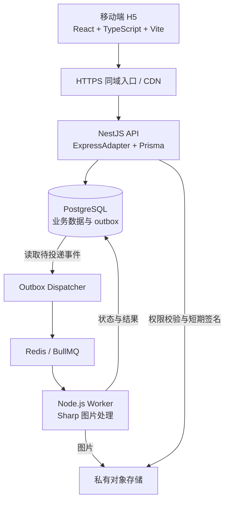
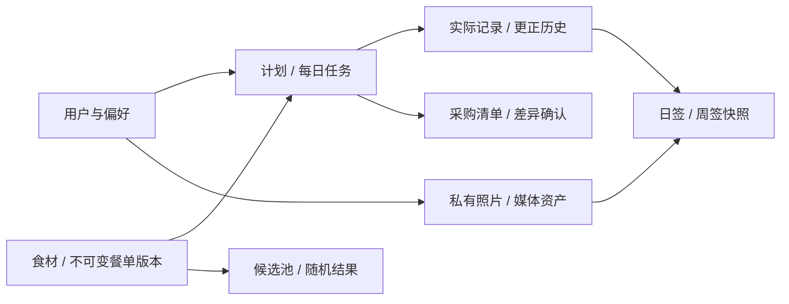

# 轻有间技术方案 V1

- **日期**：2026-11-22
- **产品形态**：移动端 H5，基于已确认的「轻有间」24 页 UI。
- **技术要求**：React 前端、Node.js 后端，采用适合当前产品的成熟主流生态。
- **主选型**：React + TypeScript + Vite；NestJS + ExpressAdapter；PostgreSQL + Prisma；Redis + BullMQ；Sharp + 私有对象存储。
- **文档状态**：技术设计与接口草案；具体依赖版本在工程初始化时按官方支持矩阵验证并锁定。
- **阅读方式**：架构与领域关系使用 Markdown 内的 Mermaid 源码；数据模型、全部 47 项接口和实施顺序均包含在本文，不依赖外部 SVG 或 JSON 文件。

## 01 / 技术选型与结论

首版采用 **React 移动端 H5 + NestJS（Node.js）模块化单体**。PostgreSQL 保存业务数据，Prisma 负责数据访问与迁移，Redis + BullMQ 处理签卡图片等异步任务。所有业务代码使用 TypeScript。

| 层次 | 主选型 | 对当前产品的作用 |
| --- | --- | --- |
| 前端 | React + TypeScript + Vite | 实现已确认的 24 页移动端交互；以登录后应用体验为主，采用 SPA。 |
| 路由与数据 | React Router + TanStack Query | 页面切换、URL 日期、服务端缓存、请求状态、变更后刷新。 |
| 表单与样式 | React Hook Form + Zod；CSS Modules + CSS 变量 | 偏好、计划和打卡表单；保留岩蓝·暖纸与自定义组件。 |
| 后端 | NestJS + 显式 ExpressAdapter | 使用成熟的模块、注入、Guard、DTO、异常处理和接口文档约定。 |
| 契约 | @nestjs/swagger + class-validator / class-transformer | 运行时校验与 OpenAPI 文档；前端 SDK 从 OpenAPI 生成。 |
| 数据库 | PostgreSQL + Prisma | 计划、实际记录、约束、版本快照、事务和迁移。 |
| 异步任务 | Redis + BullMQ / @nestjs/bullmq | 签卡渲染、图片标准化、数据导出、失败重试；业务事实仍在 PostgreSQL。 |
| 图片与存储 | Sharp + 服务端固定 SVG 模板；私有对象存储 | 生成稳定的 PNG 签卡，管理用户餐照和下载权限。 |
| 工程 | pnpm workspace、ESLint、Prettier、Vitest / Nest 测试工具、Playwright、Docker | 统一开发、校验、集成测试、移动端 E2E 与部署。 |

选择标准是生态成熟、团队容易接手、与当前功能规模匹配。首个开发里程碑会确定 Node 官方仍受支持的 LTS，以及 React、Nest、Prisma、驱动的兼容稳定版本，锁定 lockfile、镜像与字体版本。此方案不把“最新”当作兼容保证。Nest 适配器显式配置，避免依赖框架默认值的未来变化。

选型依据：[React 建项说明](https://react.dev/learn/build-a-react-app-from-scratch)、[Node LTS 策略](https://nodejs.org/en/about/previous-releases)、[Nest 文档](https://docs.nestjs.com/)、[Nest 队列集成](https://docs.nestjs.com/techniques/queues)。

## 02 / 首版边界与已有设计对齐

用户端为 H5，优先适配 iPhone Safari 与微信内置浏览器，再验证 Android Chrome 与微信。当前 UI 使用 390 × 844 作为设计参考；开发必须适应不同屏宽、系统缩放、键盘和安全区。

- 完成饮食偏好、21 天周期、一周预览、换餐、手动运动安排与打卡。
- 提供基础食材、整餐菜谱、外食组合、收藏、自建和来源链接。
- 推荐、随机、转盘基于同一份服务端候选规则。
- 支持月历、补记、更正、撤销、食材清单、日签、周签和私人相册。
- 内容先以受控导入与审核发布维护；用户端保持移动优先，内容维护工具另行管理。

配餐首版采用规则、标签和评分，可解释、可测试。健康目标首先组织习惯与计划；营养数据按来源显示估算，不自动推导医学热量处方或“减掉多少脂肪”。拍照识餐、设备同步、AI 营养师和社交排行榜另设后续工作包。

后续原生微信小程序可以复用后端、OpenAPI、设计参数和纯 TypeScript 逻辑。React DOM 页面、CSS、浏览器路由、Cookie 与分享能力需要另做实现；本方案不预建无实际使用者的跨端框架。

平台边界：[React DOM](https://react.dev/reference/react-dom)、[微信小程序开发差异](https://developers.weixin.qq.com/miniprogram/dev/framework/quickstart/)。

## 03 / 总体架构与运行方式



一个仓库管理 web、API 和 worker。API 与 worker 使用同一套契约和配置约定，分别运行，图片处理的 CPU / 内存压力不阻塞普通接口。首版用同一 PostgreSQL 实例管理业务表与 outbox，Redis 专注队列及限流辅助，不保存计划和记录的唯一事实。

浏览器通过同域 HTTPS 入口访问静态资源和 `/api/v1`。照片通过短期上传凭据直传对象存储，再由 API 核验并登记；图片读取始终先鉴权。H5 路由回退只处理前端路径，不能吞掉 API 的 404 或图片路径。

不拆微服务，也不先引入独立搜索引擎。食物库初期用 PostgreSQL 的过滤与搜索即可；如真实数据量和查询分析证明需要，再增加专门索引或搜索服务。

## 04 / React 前端设计

### 页面与状态

按功能组织 `today / meals / plans / calendar / records / signs / profile`。路由携带日期、计划 ID、餐单 ID 等可恢复状态；弹层、份量和未提交表单放局部 state / reducer。React Hook Form + Zod 处理表单，后端 DTO 始终做权威校验。

TanStack Query 管理远端数据。建议 query key 带用户、日期、计划和资源 ID；登录/退出清理跨用户缓存。打卡成功后失效 today、对应日期 calendar、plan 和相关 report 查询。服务端确认前显示“保存中”，不提前增加完成数。显式配置 staleTime、重连刷新和请求取消；版本变化或冲突时保留表单并重新读取。

### 视觉落地

使用 CSS Modules 与 CSS 变量实现岩蓝 `#344F60`、暖纸白 `#F7F5F0`、浅燕麦 `#EEE9DF`、陶杏 `#BD967C`。公共组件包括页面骨架、底部导航、餐单卡、日期条、筛选、可访问弹层、表单与签卡。按钮触控区域至少 44，主按钮参考高度 48；弹层处理焦点、滚动锁与返回键。

### 真实 iOS 页面

**顶部时间、信号、电池由系统／浏览器提供，H5 不重复绘制。** 设计图的 44 / 34 是参考，不作为所有手机的固定高度。底部背景可以延伸进安全区，导航文字和按钮必须位于安全区之上。

```
<meta name="viewport"
  content="width=device-width, initial-scale=1, viewport-fit=cover">

.app { min-height: 100vh; min-height: 100dvh; }
.topbar { padding-top: env(safe-area-inset-top, 0px); }
.bottom-nav {
  padding-bottom: env(safe-area-inset-bottom, 0px);
}
.page-with-nav {
  padding-bottom: calc(var(--tabbar-content-height)
    + env(safe-area-inset-bottom, 0px) + 16px);
}
```

所有内边距只由一层布局负责，避免安全区叠加。测试动态地址栏、键盘弹起、横屏、系统大字、低网速、减少动态效果。首版保留失败表单并显式重试，不做后台自动补交打卡。

依据：[WebKit 安全区](https://webkit.org/blog/7929/designing-websites-for-iphone-x/)、[Query 默认行为](https://tanstack.com/query/latest/docs/framework/react/guides/important-defaults)、[SPA 部署](https://reactrouter.com/how-to/spa)。

## 05 / NestJS 模块与工程目录

模块按业务职责划分：**Identity、Preferences、Catalog、Planning、Records、Discovery、Groceries、Media、Signs**。HTTP Controller 保持薄；每个模块对外提供少量业务动作，把权限、约束、事务和错误集中在调用入口，避免前端分别拼装规则。Prisma 类型不作为公开接口类型。

| 模块 | 主要动作与责任 |
| --- | --- |
| Planning | 生成草案、启用、重排未来、换餐、临时休息；统一处理版本与历史保护。 |
| Records | 保存、更正、补记、撤销；统一计算当天状态，标记签卡过期。 |
| Discovery | 候选筛选、推荐解释、候选快照、服务端随机；加入计划时由 Planning 再验。 |
| Signs | 一致快照、隐私裁剪、模板版本、任务生成、签卡新旧状态与下载。 |
| Catalog / Media | 内容版本、来源和过敏证据；媒体归属、校验与私有访问。 |

```
apps/
  web/src/{app,features,components,styles}
  api/src/modules/{identity,preferences,catalog,planning,records,
                   discovery,groceries,media,signs}
  worker/src/{outbox-dispatcher,processors}
packages/
  api-client/       # 从 OpenAPI 生成
  contracts/        # 共享枚举与传输约定，不包含 ORM 实体
  sign-renderer/    # 固定模板、字体、快照到图片的转换
infra/             # Docker、反向代理、环境与迁移流程
```

使用 Nest Guard 统一认证与管理员权限；DTO + ValidationPipe 做白名单与嵌套校验；公开接口由 `@nestjs/swagger` 输出。前端校验提升体验，服务端约束决定能否写入。无需为每张表建立抽象仓储层；变化集中在短信、对象存储等真实外部接入处。

## 06 / 数据模型、约束与索引



数据库关系使用 UUID 等不含业务秘密的 ID；数量与营养使用定点精度，预算以分为单位；未知营养保存为空而不是 0。业务日期用 `date`，事件时刻用 `timestamptz`，计划单独保存 IANA 时区。

| 表／分组 | 关键字段 | 约束与说明 |
| --- | --- | --- |
| `users` 用户 | id, display_name, default_time_zone, data_revision | 默认 Asia/Shanghai；计划另存时区；不默认采集体重、疾病等字段。 |
| `identities / sessions` 身份与会话 | user_id, provider, subject_hash / token_hash, expires_at | provider+subject 唯一；会话只存不可逆令牌摘要，支持退出与撤销。 |
| `preference_versions` 偏好版本 | id, user_id, revision, allergens, dislikes, scenes, time_limit, budget | 不可变版本；推荐池保存版本号，修改过敏条件会使旧候选失效。 |
| `ingredients` 基础食材 | id, name, current_revision, canonical_unit, conversion_metadata | 维护当前信息；已发布餐单内保留用量、营养与原料信息快照。 |
| `meal_options` 餐单主体 | id, owner_id?, kind, visibility, current_version_id, status | kind=HOME_RECIPE/OUTSIDE_COMBO；私有餐单只对所有者可见。 |
| `meal_versions` 不可变餐单版本 | id, meal_id, version, title, servings, cook_minutes, cost_range, nutrition, published_at | meal_id+version 唯一；发布后只新增版本；来源、估算标记和时效一并保存。 |
| `meal_ingredients` 餐单用料 | meal_version_id, ingredient_id, quantity, unit, mass_basis, ingredient_snapshot | 生重、熟重、毫升、个数分开；营养和采购换算都需要已知转换系数。 |
| `allergen_assessments` 过敏证据 | meal_version_id, allergen_code, assessment, evidence, checked_at, valid_until? | CONTAINS / MAY_CONTAIN / ABSENT / UNKNOWN；自动筛选要求用户所选过敏原具有有效 ABSENT 信息。 |
| `meal_sources / favorites` 来源与收藏 | meal_version_id, platform, url, author?, source_type / user_id, meal_id | 来源区分参考做法与营养数据；收藏 user_id+meal_id 唯一。 |
| `plans` 计划周期 | id, user_id, start_date, end_date, time_zone, status, revision | DRAFT / ACTIVE / ENDED / CANCELLED；每用户最多一个 ACTIVE 计划；结束不表示全部完成。 |
| `plan_items` 每日任务 | id, plan_id, local_date, slot, meal_version_id?, workout_snapshot?, disposition, revision | plan_id+local_date+slot 唯一；v1 每天最多早餐/午餐/晚餐/运动四个计划槽位。 |
| `plan_item_changes` 计划变更 | item_id, actor_id, before_snapshot, after_snapshot, reason, created_at | 换餐、改期和临时休息留痕；历史日期不通过删除任务改变分母。 |
| `records` 实际记录 | id, user_id, plan_item_id?, type, local_date, time_zone, occurred_at, actual_snapshot, revision, revoked_at? | 每个 plan_item 仅一个未撤销记录；额外记录可不关联计划；份量和实际时长独立保存。 |
| `record_changes` 记录更正 | record_id, actor_id, old_revision, new_snapshot, action, created_at | 编辑、补记、撤销保留版本；撤销不删除原计划。 |
| `draw_pools` 候选池 | id, user_id, preference_version, candidate_snapshot, pool_hash, expires_at | 最多 8 个转盘扇区；建议默认 6 个；池内候选顺序固定。 |
| `draw_results` 抽取结果 | id, pool_id, user_id, result_index, meal_version_id, created_at | 同一次幂等请求返回相同结果；加入计划前独立复核当前规则。 |
| `grocery_lists / list_items` 食材清单 | list: user_id, date_range, plan_revision; item: key, amount, unit, basis, source_refs, checked_state | 合并键含食材、生熟状态与单位维度；数量增加标记待复核，不静默沿用已备齐。 |
| `media_assets` 私有资产 | id, user_id, storage_key, mime, byte_size, dimensions, purpose, status | UPLOADING / READY / REJECTED / DELETED；头像、餐照、签卡分别控制用途。 |
| `sign_reports` 签卡与统计快照 | id, user_id, kind, date_range, time_zone, snapshot_hash, snapshot, template_version, privacy_hash, render_status, is_stale, asset_id | 相同快照+模板+隐私参数去重；旧图片可保留，修改记录后标记过期。 |
| `idempotency_keys` 请求幂等 | user_id, method, route, key, request_hash, response, expires_at | 作用域内唯一；同 key 不同请求体报冲突；至少覆盖客户端最长重试窗口。 |
| `outbox_events` 跨库投递事件 | id, event_type, payload, available_at, lease_until, attempts, published_at | 与业务变更在 PostgreSQL 同事务写入；投递 Redis 成功后确认；允许重复投递，消费者必须幂等。 |

关键数据库约束包括：每用户一个 ACTIVE 计划的部分唯一索引、任务槽位唯一、每个任务一个未撤销记录的部分唯一索引、餐单版本唯一、收藏唯一、幂等作用域唯一。跨资源写入使用复合归属约束或在同一事务校验 owner，不靠前端隐藏按钮。

主要查询索引：`plans(user_id, status)`、`plan_items(plan_id, local_date)`、`records(user_id, local_date, revoked_at)`、`draw_pools(user_id, expires_at)`、`sign_reports(user_id, period_start, period_end)`、`outbox_events(published_at, available_at)`。需要 Prisma 不能直接声明的部分索引时，使用受版本管理的 SQL migration。

## 07 / 配餐、随机与打卡的核心规则

### 配餐与推荐

1. 按公开／私人权限、发布状态、餐次与场景生成基础池。
2. 对用户所选过敏原，要求有效的“已核对不含”信息；含有、可能含有、未知及证据过期都排除。调味品也进入核验；不输出绝对安全保证。
3. 应用明确设置的时间、预算等筛选。候选不足时提示调整软条件，不静默放宽过敏或忌口。
4. 按喜好、时间预算、近期重复和备餐复用评分，返回可解释理由。v1 不建立医学热量优化器。

21 天计划一次生成全周期任务，首屏预览第一周的 21 餐和运动安排；之后按周调整未来内容。过去日期与已完成项不参与重生成。候选不足时允许更少种类或用户调整软条件，不填入未知来源餐食凑数。

### 随机与转盘

创建短期候选池，保存偏好版本、餐单版本、候选顺序与过期时间。随机和转盘调用同一个服务端抽取动作；建议转盘 6 个候选，池内等概率。Node 用 `crypto.randomInt` 生成结果索引，前端只把动画停到该索引。结果重试使用同一幂等 key。确认加入时重新核验所有权、当前偏好、餐单状态与目标任务版本。

### 打卡与更正

计划是“准备做什么”，record 是“实际做了什么”。换餐只更新未来或当日未完成计划；已经打卡则走实际记录更正。保存成功后才增加完成数；重复点击和网络重试都不能产生双份记录。额外运动可计入实际总分钟数，但不凭空增加计划完成分子。

休息日原本不生成运动任务。当天临时休息可标记运动任务 EXCUSED，保留原因并在统计单列“已调整”，不算完成或失败；三餐跳过仍保留在应完成数。过去日期不通过删除计划改变分母，只允许更正实际记录。

## 08 / 事务、并发、日期与统计

所有人可见的统计由后端返回统一结果。每条计划任务和实际记录带 revision；修改提交 `expectedRevision`，不匹配返回 `409 REVISION_CONFLICT`，保留用户输入，刷新后再确认。写入事务锁定目标任务并校验所有权，数据库唯一约束负责最后一道防重复。

```
保存打卡：
1. 开启事务 → 校验用户、计划日期、任务类型与 revision
2. 保存/更正唯一的实际记录与不可变内容快照
3. 写入更正事件，更新任务相关版本
4. 将受影响时间段的旧签卡标记 is_stale
5. 提交 → 返回 record + dayStats → 前端刷新关联查询
```

幂等 key 由前端在一次用户动作开始时创建，重试沿用；服务端以用户、方法、资源路径和 key 唯一，并校验请求体 hash。同 key 不同内容返回冲突。幂等结果与业务写入同事务保存；过期清理不能代替资源的唯一约束。

默认时区 Asia/Shanghai，创建计划时固定；旅行或修改用户默认时区不重算旧计划的业务日期。周一为周起点，按当地日期划分日历；事件存 UTC，归属日保存为 local_date。不得用 UTC 的 `toISOString().slice(0,10)` 直接判断用户“今天”。补记时验证发生时刻与所选业务日期一致，不接受明显未来的实际记录。

完成率 = 已完成的计划任务数 / 应完成的计划任务数。示例周：18/21 餐 + 4/5 次运动 = 22/26 ≈ 85%。未来日期不计失败；分母为 0 时显示“无安排”；签卡按生成时快照保存。修改历史记录会使旧签卡过期，但不偷偷修改已经保存的图片。

## 09 / 接口清单与关键契约

接口前缀为 `/api/v1`。成功返回业务 data 与 requestId；失败使用正确 HTTP 状态及稳定错误码，不把异常包装成 HTTP 200。列表采用 cursor + limit；日历只返回聚合，明细按日期加载。接口返回值不直接暴露数据库实体。

```
{ "data": { "id": "...", "revision": 3 }, "requestId": "..." }
{ "error": { "code": "REVISION_CONFLICT", "message": "内容已变更，请刷新后确认" },
  "requestId": "..." }
```

典型错误：401 未登录、403 无权限、404 资源不存在、409 版本/重复动作冲突、422 参数或业务条件不满足、429 请求过频、503 依赖暂不可用。空候选返回 `NO_ELIGIBLE_MEALS` 和可调整软条件，网络失败不能伪装成“没有餐单”。

| 方法与路径 | 作用与访问 | 请求字段 | 响应要点 | 规则与约束 |
| --- | --- | --- | --- | --- |
| `GET /api/v1/auth/csrf` | 获取写入保护 token / PUBLIC | — | csrfToken | 配合同源校验与安全 Cookie；不包含用户业务信息。 |
| `POST /api/v1/auth/otp` | 申请验证码 / PUBLIC | phone, scene | challengeId, retryAfter | 限流、防枚举；不记录明文验证码。 |
| `POST /api/v1/auth/sessions` | 验证码登录 / PUBLIC | challengeId, phone, code | user, expiresAt + HttpOnly Cookie | 开发与生产通道隔离；先接账号供应商，再开放真实发送。 |
| `DELETE /api/v1/auth/session` | 退出登录 / USER | — | 操作结果 | 撤销当前服务端会话并清 Cookie。 |
| `GET /api/v1/me` | 用户及当前计划摘要 / USER | — | user, preferencesRevision, activePlan | 按资源归属与统一协议处理 |
| `PUT /api/v1/me/preferences` | 保存新偏好版本 / USER | expectedRevision, preferences | newRevision | 保存不可变偏好版本；旧候选池加入计划时必须重新校验。 |
| `GET /api/v1/me/favorites` | 获取收藏 / USER | — | cursor page of meal options | 按资源归属与统一协议处理 |
| `PUT /api/v1/me/favorites/{mealId}` | 收藏餐单 / USER | — | 操作结果 | 资源唯一，重复收藏无额外副作用。 |
| `DELETE /api/v1/me/favorites/{mealId}` | 取消收藏 / USER | — | 操作结果 | 按资源归属与统一协议处理 |
| `GET /api/v1/me/signs` | 签卡相册 / USER | — | reports, freshness, nextCursor | 按资源归属与统一协议处理 |
| `POST /api/v1/me/data-export` | 发起本人数据导出 / USER | — | exportRequestId | 私有异步导出，下载链接短期有效。 |
| `GET /api/v1/me/data-export` | 查看本人数据导出状态 / USER | — | 私有下载任务或结果 | 按资源归属与统一协议处理 |
| `DELETE /api/v1/me` | 申请删除本人数据 / USER | confirmation | deletionRequestId | 撤销会话、删除私有资产；备份按既定保留周期到期。 |
| `GET /api/v1/ingredients` | 基础食材搜索 / PUBLIC | query, cursor, limit | ingredients | 按资源归属与统一协议处理 |
| `GET /api/v1/meals` | 餐单、外食与私人食物池 / OPTIONAL_USER | query, kind, scene, favorites, cursor | meal summaries | 游客仅公开内容；私人内容需登录；不把搜索结果自动视为过敏推荐。 |
| `GET /api/v1/meals/{mealId}` | 当前餐单详情 / OPTIONAL_USER | version? | mealVersion, ingredients, sources, allergyInfo | 按资源归属与统一协议处理 |
| `POST /api/v1/meals` | 创建私人餐单 / USER | recipe/combo with source and quantities | private meal draft | 默认 PRIVATE；未知过敏信息不进入自动池。 |
| `POST /api/v1/plan-drafts` | 生成整个周期草案 / USER | startDate, durationDays, preferencesRevision, weeklyWorkouts | draftId, revision, firstWeek, entireCycleSummary | Idempotency-Key；21 天生成全周期，首屏只预览第一周。 |
| `GET /api/v1/plans/{planId}` | 查看计划 / USER | dateFrom?, dateTo? | plan, items, revision | 按资源归属与统一协议处理 |
| `POST /api/v1/plans/{planId}/activate` | 启用草案 / USER | expectedRevision | active plan | 事务检查 ACTIVE 唯一；保留原计划须显式处理。 |
| `POST /api/v1/plans/{planId}/regenerate` | 重生成未来餐次 / USER | fromDate, expectedRevision, lockedItemIds | newRevision, changes | 保留过去日期和已完成项，不放宽硬限制。 |
| `POST /api/v1/plans/{planId}/copy` | 复制未来计划 / USER | targetStartDate, durationDays | draftId | 复制计划，不复制实际记录。 |
| `POST /api/v1/plan-items/{itemId}/replace` | 换餐 / USER | mealVersionId, expectedRevision, drawId? | updated item | 事务重验归属、偏好与当前版本；已有实际记录则 409。 |
| `PATCH /api/v1/plan-items/{itemId}` | 运动改期或临时休息 / USER | expectedRevision, disposition, reason, targetDate? | updated item and stats | 仅当天/未来；历史只改实际记录；休息数量单列。 |
| `GET /api/v1/today` | 今日聚合 / USER | date? | tasks, nextMeal, completion, activePlanRevision | 按资源归属与统一协议处理 |
| `GET /api/v1/calendar` | 月历或日期范围聚合 / USER | from, to | localDate, completed, eligible, excused, state per day | 按资源归属与统一协议处理 |
| `PUT /api/v1/plan-items/{itemId}/record` | 保存该任务实际记录 / USER | expectedItemRevision, expectedRecordRevision?, occurredAt, actual | record, itemState, dayStats | Idempotency-Key；同任务最多一个未撤销记录，创建和修改均防并发覆盖。 |
| `POST /api/v1/records` | 额外饮食或运动记录 / USER | localDate, occurredAt, type, actual | record | 不自动计入计划完成分子；可计入实际时长等独立统计。 |
| `PATCH /api/v1/records/{recordId}` | 更正实际记录 / USER | expectedRevision, changes | record, dayStats | 事务改版本并标记相关签卡过期。 |
| `POST /api/v1/records/{recordId}/revoke` | 撤销打卡 / USER | expectedRevision | revoked record, dayStats | 逻辑撤销；原计划保留；重复撤销不重复扣数。 |
| `POST /api/v1/draw-pools` | 创建合规候选池 / USER | slot, scene, timeLimit, budget, preferencesRevision, mode | poolId, candidates, expiresAt | 0 候选返回 422 NO_ELIGIBLE_MEALS；仅建议调整软条件。 |
| `POST /api/v1/draw-pools/{poolId}/draws` | 随机或转盘抽取 / USER | mode | drawId, resultIndex, mealVersionId | Idempotency-Key；服务端 crypto.randomInt，前端只播放结果。 |
| `POST /api/v1/grocery-lists` | 按计划创建采购清单 / USER | planId, dateFrom, dateTo, servings | list, sourcePlanRevision | 已知转换才合并；无法换算分开列。 |
| `GET /api/v1/grocery-lists/{listId}` | 查看采购清单 / USER | — | items, stale, checked counts | 按资源归属与统一协议处理 |
| `POST /api/v1/grocery-lists/{listId}/refresh-preview` | 计算清单变化 / USER | expectedRevision | added, changed, removed, preserved checks | 按资源归属与统一协议处理 |
| `POST /api/v1/grocery-lists/{listId}/refresh` | 确认重新汇总 / USER | expectedRevision, previewHash | updated list | 预览后原计划改变则冲突重算。 |
| `PATCH /api/v1/grocery-items/{itemId}` | 勾选已备齐 / USER | expectedRevision, checked | updated item | 按资源归属与统一协议处理 |
| `POST /api/v1/media/upload-intents` | 申请私有上传 / USER | purpose, mime, byteSize | assetId, uploadUrl, expiry | 服务端决定对象 key；限制数量、格式、尺寸与大小。 |
| `POST /api/v1/media/{assetId}/complete` | 完成上传并校验 / USER | upload proof? | asset status | 不能仅信任前端 complete；服务器核验归属、对象与实际内容。 |
| `GET /api/v1/media/{assetId}/access` | 获取本人资产短期地址 / USER | — | signedUrl, expiresAt | 每次校验归属；未标准化资产不可用于签卡。 |
| `DELETE /api/v1/media/{assetId}` | 删除本人资产 / USER | — | 操作结果 | 逻辑撤销访问并异步清理对象；被引用照片按删除策略处理。 |
| `POST /api/v1/sign-reports` | 生成日签或周签 / USER | kind, periodStart, templateId, privacy, photoAssetId? | reportId, renderStatus | 服务端生成一致快照，签卡行与 outbox 同事务提交，再异步投递 BullMQ。 |
| `GET /api/v1/sign-reports/{reportId}` | 查看生成状态 / USER | — | renderStatus, isStale, previewUrl?, expiresAt, retryAfter? | 按资源归属与统一协议处理 |
| `POST /api/v1/sign-reports/{reportId}/retry` | 重试失败的图片任务 / USER | expectedRevision | report status | 仅本人；同快照重试，不偷偷替换为新统计。 |
| `POST /api/v1/sign-reports/{reportId}/download` | 获取私有下载地址 / USER | — | signedUrl, filename, expiresAt | 仅导出卡片，不带系统状态栏、按钮与内部标识。 |
| `POST /api/v1/admin/meals/import-preview` | 内容导入校验 / STAFF | versioned JSON content | validation report | 受控 CLI 调用；不额外开发桌面产品。 |
| `POST /api/v1/admin/meal-versions/{versionId}/publish` | 发布审核后的内容 / STAFF | expectedRevision, review evidence | published version | 营养来源与过敏证据必填或明确 UNKNOWN；发布后不原地覆盖。 |

以上为初版接口清单，PUBLIC / USER / STAFF 表示访问范围；OPTIONAL_USER 表示游客只读公开内容、登录后可读本人私人内容。开发中由真实 DTO 与 Controller 生成 OpenAPI，并据此生成前端 SDK；CI 检查契约变更，避免手写两套类型逐渐分离。

## 10 / 签卡、队列与图片处理

### 生成链路

1. 用户进入签卡页，API 读取一致的日期范围数据，计算完成率和实际统计。
2. 按隐私白名单裁剪快照：默认不含体重、身体照片、用户备注和内部 ID；照片只在用户明确选择后加入。
3. 计算 snapshotHash + templateVersion + privacyHash + renderer/fontVersion，查找可复用结果。
4. 在 PostgreSQL 同一事务写入 sign_report(PENDING) 和 outbox_event。
5. outbox dispatcher 用短事务领取事件与租约，事务外向 BullMQ 投递；成功后标记 published。
6. Worker 从已保存快照渲染固定 SVG，Sharp 输出 PNG，写私有存储并更新 READY。
7. 页面短轮询状态，图片 READY 后启用保存和分享；失败给出重试。

### 跨库一致性

**PostgreSQL 事务不能自动包含 Redis 入队。** 用事务 outbox 防止“签卡已创建但任务丢失”。事件 ID 作为队列 jobId，状态与业务处理仍需幂等：投递后确认前崩溃会重投，BullMQ job 也可能重试，不能承诺端到端恰好一次。

Worker 以 reportId 和内容 hash 使用稳定对象键，数据库终态更新做条件检查；同结果重复执行可直接返回。对象存储上传在 SQL 事务外，失败时允许重做，孤立对象定期清理。Redis 暂不可用时，outbox 保留待投递任务；普通计划与打卡仍可运行，签卡显示排队中。

定期补偿扫描长期 PENDING / 已过期执行租约的签卡；若 PostgreSQL 仍有生成意图，而 Redis 中没有有效运行任务，则按原快照重新投递。这样也覆盖 Redis 已接收后丢失队列数据的恢复场景；有限重试已进入 FAILED 的任务不由补偿扫描无限重试。

初始渲染并发设 1，按压测调整。区分可重试错误与配方/资源永久错误；配置重试次数、指数退避、任务保留、执行上限与失败终态。执行上限需要真正停止渲染进程，不能只用 Promise.race 伪装取消。

### 图像和字体

沿用设计稿中 342 × 561 的签卡逻辑画布，默认导出 3 倍 PNG（1026 × 1683）。服务端模板只接受白名单字段，用户文案限长并 XML 转义；不接受用户任意 SVG、字体路径或外部 URL。上传照片先标准化，限制文件、像素和解码资源，去除 EXIF 后再用于模板。

Linux Worker 配置固定、授权可部署的中文字体和 fontconfig；不复制设计电脑的系统字体文件。字体随镜像版本管理，以真实中文样张验证换行与数字。HEIC 单列输入格式兼容验收，不能默认所有服务器或浏览器都会转换。

依据：[Nest BullMQ](https://docs.nestjs.com/techniques/queues)、[Nest 事务 outbox](https://docs.nestjs.com/reliability/outbox)、[BullMQ 幂等任务](https://docs.bullmq.io/patterns/idempotent-jobs)、[Sharp 字体](https://sharp.pixelplumbing.com/install/#fonts)、[Sharp 安全约束](https://sharp.pixelplumbing.com/security/)。

## 11 / 食材清单与外部内容

采购按计划、日期范围和人数汇总。合并键至少含食材 ID、采购状态（生/熟）、单位维度；有明确转换系数才合并。“150 g 熟米饭”不能无依据变成“50 g 生米”，“两个鸡蛋”不能在没有规格时自动换成统一克数。不可换算就分行展示，并保留来源餐次。

换餐后清单标记 stale，重新汇总先返回差异预览。未变项目保留勾选；数量增加保留原勾选历史但显示 NEEDS_REVIEW，要求确认库存，不能悄悄显示全部已备齐。设计中糙米与燕麦可视觉合并，但数据上是两个项目。

外站内容保存原文标题、平台、作者（已知时）、URL、链接校验时间和用途。下厨房页面只是相似做法；小红书优先给搜索词。外部内容与营养数据来源分开，用户未知配料的外食组合只作为手动搭配参考，不自动进入过敏推荐池。

首版不建立通用网页抓取器。只保存和展示允许的 HTTPS 原文链接，服务端不任意访问用户 URL；浏览器使用安全外链方式，微信容器不支持时给复制链接／搜索词和手动选择文本的退路。

## 12 / 登录、资产与安全

默认按手机号验证码登录设计，账号供应商在接入时选定；游客可以浏览公开餐单与示例计划，首次保存时登录。若已有统一账号，复用 Identity 模块接入。短信发送和验证码接口限流，日志不记录验证码、完整手机号或完整会话令牌。

H5 与 API 同源，生产使用可撤销的服务端 Session，Cookie 显式设置 HttpOnly、Secure、SameSite=Lax、Path=/；符合条件时使用 __Host- 前缀。写入接口校验来源与 CSRF token。API 对每个计划、记录、候选池、私人餐单、图片和签卡检查用户归属。

对象存储保持私有。API 发短期上传凭据并决定对象 key；complete 后核验真实对象、归属、格式和大小，不能相信前端自报。读取时先鉴权再签名；短期签名地址是持有者可访问的凭据，不等于一次性链接，不写入公开日志。国内 OSS/COS/S3 兼容实现需核验所选供应商的权限语义。

用户删除照片、签卡或账号后，撤销系统内访问并清理对象；数据库备份按已公布的保留策略到期。主动下载或分享出去的副本属于外部文件，系统不能远程撤回。用户内容默认私人，公开内容发布需要 STAFF 权限与审核。

依据：[Cookie 标准](https://www.rfc-editor.org/rfc/rfc6265.html)、[签名 URL 的访问语义](https://docs.aws.amazon.com/AmazonS3/latest/userguide/using-presigned-url.html)。具体账号、存储供应商的集成仍需单独验收。

## 13 / H5 保存、分享与浏览器兼容

H5 不承诺直接写入系统相册。图片 READY 后，支持的浏览器可用文件分享；通过 navigator.canShare({files}) 探测，且必须由用户点击触发。异步渲染完成后自动调用分享，可能已经失去用户激活，因此按钮在图片可用时再启用。

不支持时打开高清图片预览并提示长按保存，或使用带合适 Content-Disposition 的下载入口；处理图片地址过期后重新申请。复制功能在安全上下文调用 Clipboard API，失败时显示可手动选择的文本。

微信 JS-SDK 的分享信息定制需要公众号／服务号、JS 接口安全域名和服务端签名；它设置分享内容，不代表可以自动把消息发给好友。首版可以先完成图片生成、预览和手动保存，把微信定制分享作为账号条件具备后的增强。

依据：[Web Share 标准](https://www.w3.org/TR/web-share/)、[下载规范](https://html.spec.whatwg.org/multipage/links.html#downloading-resources)、[微信 JS-SDK](https://developers.weixin.qq.com/doc/service/guide/h5/jssdk)。

## 14 / 部署、内容维护与运维

- **运行单元：**web 静态资源、Nest API、worker/dispatcher、PostgreSQL、Redis、私有对象存储。开发可用 Docker Compose；生产优先复用团队已有托管资源。
- **内容：**以版本化 JSON/表单导入，先校验再审核发布。缺失过敏证据不填“安全”；发布后的纠错新增版本，旧计划和记录保留原版。
- **发布：**CI 做类型检查、lint、单元/集成/E2E、构建与镜像；数据库迁移作为独立部署步骤，仅一个执行者运行。采用先扩展再切换的兼容迁移，应用回滚不盲目反向删数据。
- **环境：**本地、测试和生产隔离，单独短信通道、存储 bucket、数据库和密钥。Vite 暴露到浏览器的变量只放公开配置；数据库、短信和存储密钥只在服务端。
- **观测：**结构化 requestId 日志；接口错误率、P95、outbox 积压、队列等待、失败任务、渲染耗时和对象失败率。记录必要资源 ID，不输出餐照、备注、验证码、令牌或完整签名 URL。
- **恢复：**数据库备份、对象生命周期和 Redis 持久化策略上线前确定；至少演练数据库恢复、Redis 丢任务后的 outbox 重投和 worker 重启。

Redis 为队列保留资源，遵循 BullMQ 所需连接、持久化与淘汰配置；不能把可能被随意淘汰的普通缓存实例直接当可靠任务队列。数据库连接池按 API、worker 和管理工具的总和规划，避免实例数增长后耗尽连接。

## 15 / 验收与关键测试

| 层次 | 必须验证的行为 |
| --- | --- |
| 领域测试 | 过敏 UNKNOWN / MAY_CONTAIN 排除；随机索引在固定候选内；生熟与单位不可误合并；零分母、休息日、未来日期、额外记录。 |
| 真实数据库集成 | 重复保存只计一次；两个端并发更改不覆盖；事务失败不残留记录；跨用户访问被拒绝；outbox 与业务一起回滚。 |
| 故障注入 | Redis 断开、投递后进程崩溃、worker 重复执行、对象上传后数据库写回失败；能够重试且不出现双份签卡／虚假成功。 |
| Web E2E | 登录 → 定计划 → 选餐/转盘 → 确认换餐 → 打卡 → 撤销 → 日历 → 生成签卡。Playwright WebKit 用于自动化，不能代替真机。 |
| 真机与视觉 | iOS Safari、iOS 微信、Android Chrome、Android 微信；320–430 宽度、键盘、大字、地址栏、安全区、图片下载/分享、HEIC 输入。 |
| 图片样张 | 中文字体、长昵称、长文案、缺照片、透明图、异常图片、隐私开关与重复生成；签卡不带状态栏或按钮。 |

初始性能验收目标：在约定测试环境和负载下，常规读取 P95 ≤300 ms、写入 ≤500 ms、21 天计划草案 ≤2 s；标准签卡排队之外渲染目标 ≤5 s。它们是待压测确认的目标，不是现有服务承诺。图片缩略图、列表分页、按页面分包和聚合接口优先于提前堆缓存。

## 16 / 建议开发顺序与进入条件

| 里程碑 | 具体产出 | 通过标准 |
| --- | --- | --- |
| M1 工程底座 | 锁定兼容版本、monorepo、主题组件、iOS 布局、Nest 会话、数据库迁移、OpenAPI/SDK、CI、测试环境。 | 一条真实接口到 React 的完整链路；登录权限、字体/图片与存储基础验证。 |
| M2 食物与计划 | 内容导入发布、偏好、餐单详情、外食参考、收藏、全周期计划、一周预览与换餐。 | 使用审核样本创建计划；未知过敏信息不进入自动推荐。 |
| M3 日常闭环 | 今日、饮食与运动记录、补记/撤销、统一统计、月历、食材清单。 | 并发、重复、时区与清单差异测试通过。 |
| M4 趣味与成果 | 推荐解释、随机/转盘、签卡模板、outbox/BullMQ/Sharp、私人相册与保存分享退路。 | 结果一致、任务恢复、隐私导出和字体样张验收通过。 |
| M5 发布验收 | 真机、容量、恢复演练、内容审核、监控与可回滚发布。 | 关键 E2E、回滚与备份恢复通过，真实账号/存储配置就绪。 |

没有团队人数与内容准备情况时，先按工作包验收，不把工期写成确定日期。开工默认延续本方案的 H5、短信登录、PostgreSQL 与 Redis；已有账号、云资源或数据库规范可以在 M1 对接，不影响上述业务规则。

上线前需落实的外部条件：域名与 HTTPS、部署环境、账号/短信服务、私有对象存储、可部署中文字体、经过整理和审核的食物数据。微信定制分享只在相应账号与域名条件具备时启用。

## 17 / 当前主选型的官方资料

以下用于核验能力与约束；“适合本产品”是结合当前功能和维护成本的工程判断。技术方案完成日期为 2026-11-22，尚未运行实际应用、兼容矩阵或容量测试。

- [React SPA 建项](https://react.dev/learn/build-a-react-app-from-scratch)
- [Vite：TypeScript / CSS Modules](https://vite.dev/guide/features#typescript)
- [React Router](https://reactrouter.com/start/declarative/installation)
[Query 与客户端状态](https://tanstack.com/query/latest/docs/framework/react/guides/does-this-replace-client-state)

- [Node LTS](https://nodejs.org/en/about/previous-releases)
- [Nest 平台适配器](https://docs.nestjs.com/first-steps#platform)
- [Nest DTO 校验](https://docs.nestjs.com/techniques/validation)
[Swagger 插件与校验边界](https://docs.nestjs.com/openapi/cli-plugin)

- [Prisma / PostgreSQL](https://www.prisma.io/docs/orm/v7/core-concepts/supported-databases/postgresql)
- [Prisma 事务](https://www.prisma.io/docs/orm/v7/prisma-client/queries/transactions)
- [Nest / BullMQ](https://docs.nestjs.com/techniques/queues)
[事务 outbox](https://docs.nestjs.com/reliability/outbox)

- [BullMQ 生产配置](https://docs.bullmq.io/guide/going-to-production)
- [任务重试](https://docs.bullmq.io/guide/retrying-failing-jobs)
- [jobId 的生命周期](https://docs.bullmq.io/guide/jobs/job-ids)
[业务幂等](https://docs.bullmq.io/patterns/idempotent-jobs)

- [React Hook Form](https://react-hook-form.com/get-started#SchemaValidation)
- [Zod resolver](https://github.com/react-hook-form/resolvers)
- [Zod](https://zod.dev/)
[Sharp 字体](https://sharp.pixelplumbing.com/install/#fonts)

- [WebKit safe area](https://webkit.org/blog/7929/designing-websites-for-iphone-x/)
- [Web Share](https://www.w3.org/TR/web-share/)
- [微信 JS-SDK](https://developers.weixin.qq.com/doc/service/guide/h5/jssdk)
[小程序与网页差异](https://developers.weixin.qq.com/miniprogram/dev/framework/quickstart/)
